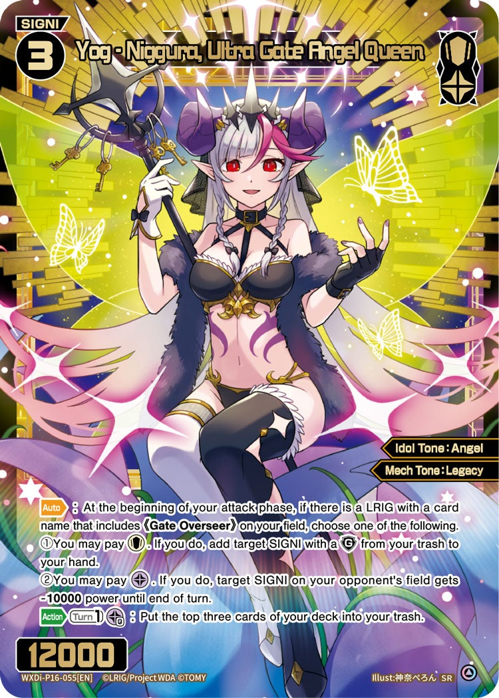

# Yog - Niggura, Ultra Gate Angel Queen

## Thông tin lá

| Trường | Giá trị |
| --- | --- |
| Mã in | WXDi-P16-055[EN] |
| Set | WXDi-P16[EN] |
| Số thứ tự | 055 |
| Loại thẻ | SIGNI |
| Vị trí | Main Deck |
| Số bản | — (set booster, không áp dụng) |
| Màu | Trắng / đen |
| Độ hiếm | SR,SRP |
| Minh họa | 神奈ぺろん |
| Level | 3 |
| Limit | — |
| Power | 12000 |
| LRIG type / Class | Idol Tone：Angel／Mech Tone：Legacy |
| Team / Master | — |
| Cost | — |
| Grow cost | — |
| Use timing | — |
| Life Burst | Không |

## Card text chính thức

[Auto]: At the beginning of your attack phase, if there is a LRIG with a card name that includes 《Gate Overseer》 on your field, choose one of the following.
①You may pay {White}. If you do, add target SIGNI with a {Guard Icon} from your trash to your hand.
②You may pay {Black}. If you do, target SIGNI on your opponent's field gets -10000 power until end of turn.
[Action] {1/Turn} {Blackx0}: Put the top three cards of your deck into your trash.

## Power text / Life Burst

—

## Ghi chú minh họa
Artist: 神奈ぺろん. Ảnh SR được tải từ Card List tiếng Anh.

## FAQ chính thức

— (không có FAQ riêng cho mã này trên trang FAQ tiếng Anh.)

## Ảnh biến thể

- [SRP](../images/WXDi-P16-055P-EN.jpg)

## Nguồn
[Card List/FAQ chính thức](https://www.takaratomy.co.jp/products/en.wixoss/card/card.html?card_no=WXDi-P16-055%5BEN%5D ) · [Ảnh thẻ](https://www.takaratomy.co.jp/products/en.wixoss/card/thumb/WXDi-P16-055%5BEN%5D.jpg)
