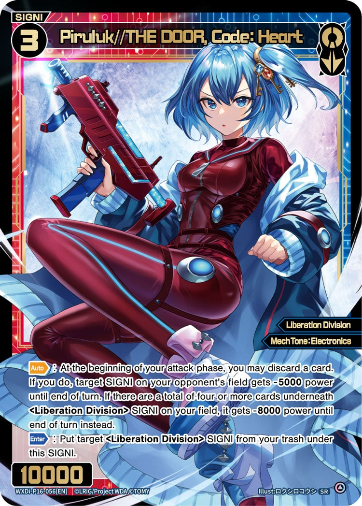

# Piruluk//THE DOOR, Code: Heart

## Thông tin lá

| Trường | Giá trị |
| --- | --- |
| Mã in | WXDi-P16-056[EN] |
| Set | WXDi-P16[EN] |
| Số thứ tự | 056 |
| Loại thẻ | SIGNI |
| Vị trí | Main Deck |
| Số bản | — (set booster, không áp dụng) |
| Màu | Xanh dương / đỏ |
| Độ hiếm | SR,SRP |
| Minh họa | ロクシロコウシ |
| Level | 3 |
| Limit | — |
| Power | 10000 |
| LRIG type / Class | Liberation Division/Mech Tone：Electronics |
| Team / Master | — |
| Cost | — |
| Grow cost | — |
| Use timing | — |
| Life Burst | Không |

## Card text chính thức

[Auto]: At the beginning of your attack phase, you may discard a card. If you do, target SIGNI on your opponent's field gets -5000 power until end of turn. If there are a total of four or more cards underneath <Liberation Division> SIGNI on your field, it gets -8000 power until end of turn instead.
[Enter]: Put target <Liberation Division> SIGNI from your trash under this SIGNI.

## Power text / Life Burst

—

## Ghi chú minh họa
Artist: ロクシロコウシ. Ảnh SR được tải từ Card List tiếng Anh.

## FAQ chính thức

— (không có FAQ riêng cho mã này trên trang FAQ tiếng Anh.)

## Ảnh biến thể

- [SRP](../images/WXDi-P16-056P-EN.jpg)

## Nguồn
[Card List/FAQ chính thức](https://www.takaratomy.co.jp/products/en.wixoss/card/card.html?card_no=WXDi-P16-056%5BEN%5D ) · [Ảnh thẻ](https://www.takaratomy.co.jp/products/en.wixoss/card/thumb/WXDi-P16-056%5BEN%5D.jpg)
