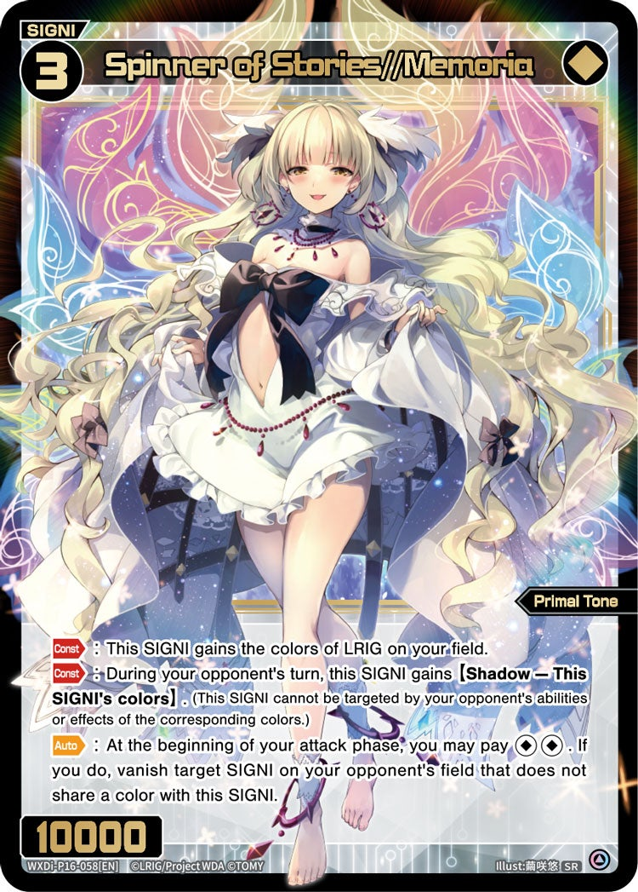

# Spinner of Stories//Memoria

## Thông tin lá

| Trường | Giá trị |
| --- | --- |
| Mã in | WXDi-P16-058[EN] |
| Set | WXDi-P16[EN] |
| Số thứ tự | 058 |
| Loại thẻ | SIGNI |
| Vị trí | Main Deck |
| Số bản | — (set booster, không áp dụng) |
| Màu | Không màu |
| Độ hiếm | SR,SRP |
| Minh họa | 繭咲悠 |
| Level | 3 |
| Limit | — |
| Power | 10000 |
| LRIG type / Class | Primal Tone |
| Team / Master | — |
| Cost | — |
| Grow cost | — |
| Use timing | — |
| Life Burst | Không |

## Card text chính thức

[Constant]: This SIGNI gains the colors of LRIG on your field.
[Constant]: During your opponent's turn, this SIGNI gains 【Shadow — This SIGNI's colors】. (This SIGNI cannot be targeted by your opponent's abilities or effects of the corresponding colors.)
[Auto]: At the beginning of your attack phase, you may pay {Colorless} {Colorless}. If you do, vanish target SIGNI on your opponent's field that does not share a color with this SIGNI.

## Power text / Life Burst

—

## Ghi chú minh họa
Artist: 繭咲悠. Ảnh SR được tải từ Card List tiếng Anh.

## FAQ chính thức

— (không có FAQ riêng cho mã này trên trang FAQ tiếng Anh.)

## Ảnh biến thể

- [SRP](../images/WXDi-P16-058P-EN.jpg)

## Nguồn
[Card List/FAQ chính thức](https://www.takaratomy.co.jp/products/en.wixoss/card/card.html?card_no=WXDi-P16-058%5BEN%5D ) · [Ảnh thẻ](https://www.takaratomy.co.jp/products/en.wixoss/card/thumb/WXDi-P16-058%5BEN%5D.jpg)
