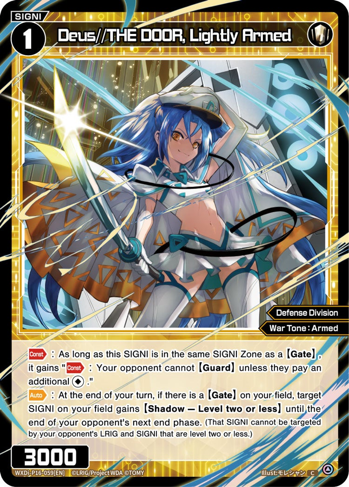

# Deus//THE DOOR, Lightly Armed

## Thông tin lá

| Trường | Giá trị |
| --- | --- |
| Mã in | WXDi-P16-059[EN] |
| Set | WXDi-P16[EN] |
| Số thứ tự | 059 |
| Loại thẻ | SIGNI |
| Vị trí | Main Deck |
| Số bản | — (set booster, không áp dụng) |
| Màu | Trắng |
| Độ hiếm | C,C(P) |
| Minh họa | モレシャン |
| Level | 1 |
| Limit | — |
| Power | 3000 |
| LRIG type / Class | Defense Division/War Tone：Armed |
| Team / Master | — |
| Cost | — |
| Grow cost | — |
| Use timing | — |
| Life Burst | Không |

## Card text chính thức

[Constant]: As long as this SIGNI is in the same SIGNI Zone as a 【Gate】, it gains "[Constant]: Your opponent cannot 【Guard】 unless they pay an additional {Colorless}."
[Auto]: At the end of your turn, if there is a 【Gate】 on your field, target SIGNI on your field gains 【Shadow — Level two or less】 until the end of your opponent's next end phase. (That SIGNI cannot be targeted by your opponent's LRIG and SIGNI that are level two or less.)

## Power text / Life Burst

—

## Ghi chú minh họa
Artist: モレシャン. Ảnh C được tải từ Card List tiếng Anh.

## FAQ chính thức

— (không có FAQ riêng cho mã này trên trang FAQ tiếng Anh.)

## Ảnh biến thể

- [C(P)](../images/WXDi-P16-059P-EN.jpg)

## Nguồn
[Card List/FAQ chính thức](https://www.takaratomy.co.jp/products/en.wixoss/card/card.html?card_no=WXDi-P16-059%5BEN%5D ) · [Ảnh thẻ](https://www.takaratomy.co.jp/products/en.wixoss/card/thumb/WXDi-P16-059%5BEN%5D.jpg)
