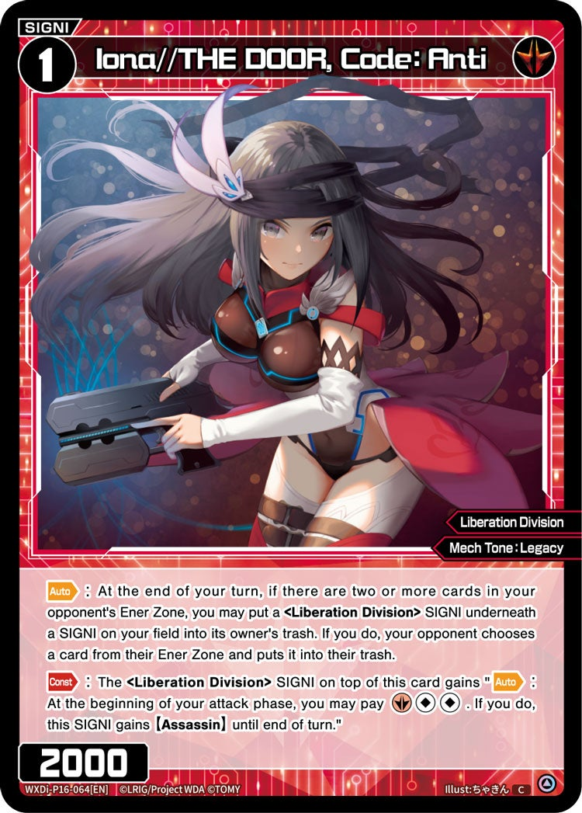

# Iona//THE DOOR, Code: Anti

## Thông tin lá

| Trường | Giá trị |
| --- | --- |
| Mã in | WXDi-P16-064[EN] |
| Set | WXDi-P16[EN] |
| Số thứ tự | 064 |
| Loại thẻ | SIGNI |
| Vị trí | Main Deck |
| Số bản | — (set booster, không áp dụng) |
| Màu | Đỏ |
| Độ hiếm | C,C(P) |
| Minh họa | ちゃきん |
| Level | 1 |
| Limit | — |
| Power | 2000 |
| LRIG type / Class | Liberation Division/Mech Tone：Legacy |
| Team / Master | — |
| Cost | — |
| Grow cost | — |
| Use timing | — |
| Life Burst | Không |

## Card text chính thức

[Auto]: At the end of your turn, if there are two or more cards in your opponent's Ener Zone, you may put a <Liberation Division> SIGNI underneath a SIGNI on your field into its owner's trash. If you do, your opponent chooses a card from their Ener Zone and puts it into their trash.

[Constant]: The <Liberation Division> SIGNI on top of this card gains "[Auto]: At the beginning of your attack phase, you may pay {Red} {Colorless} {Colorless}. If you do, this SIGNI gains 【Assassin】 until end of turn."

## Power text / Life Burst

—

## Ghi chú minh họa
Artist: ちゃきん. Ảnh C được tải từ Card List tiếng Anh.

## FAQ chính thức

— (không có FAQ riêng cho mã này trên trang FAQ tiếng Anh.)

## Ảnh biến thể

- [C(P)](../images/WXDi-P16-064P-EN.jpg)

## Nguồn
[Card List/FAQ chính thức](https://www.takaratomy.co.jp/products/en.wixoss/card/card.html?card_no=WXDi-P16-064%5BEN%5D ) · [Ảnh thẻ](https://www.takaratomy.co.jp/products/en.wixoss/card/thumb/WXDi-P16-064%5BEN%5D.jpg)
