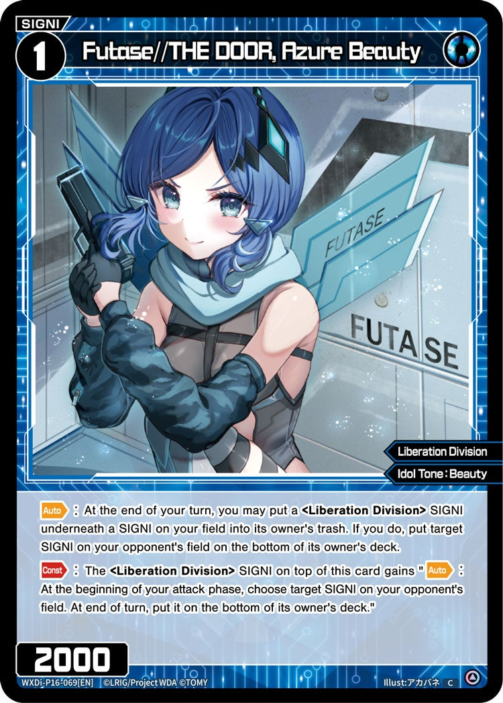

# Futase//THE DOOR, Azure Beauty

## Thông tin lá

| Trường | Giá trị |
| --- | --- |
| Mã in | WXDi-P16-069[EN] |
| Set | WXDi-P16[EN] |
| Số thứ tự | 069 |
| Loại thẻ | SIGNI |
| Vị trí | Main Deck |
| Số bản | — (set booster, không áp dụng) |
| Màu | Xanh dương |
| Độ hiếm | C,C(P) |
| Minh họa | アカバネ |
| Level | 1 |
| Limit | — |
| Power | 2000 |
| LRIG type / Class | Liberation Division/Idol Tone：Beauty |
| Team / Master | — |
| Cost | — |
| Grow cost | — |
| Use timing | — |
| Life Burst | Không |

## Card text chính thức

[Auto]: At the end of your turn, you may put a <Liberation Division> SIGNI underneath a SIGNI on your field into its owner's trash. If you do, put target SIGNI on your opponent's field on the bottom of its owner's deck.

[Constant]: The <Liberation Division> SIGNI on top of this card gains "[Auto]: At the beginning of your attack phase, choose target SIGNI on your opponent's field. At end of turn, put it on the bottom of its owner's deck."

## Power text / Life Burst

—

## Ghi chú minh họa
Artist: アカバネ. Ảnh C được tải từ Card List tiếng Anh.

## FAQ chính thức

— (không có FAQ riêng cho mã này trên trang FAQ tiếng Anh.)

## Ảnh biến thể

- [C(P)](../images/WXDi-P16-069P-EN.jpg)

## Nguồn
[Card List/FAQ chính thức](https://www.takaratomy.co.jp/products/en.wixoss/card/card.html?card_no=WXDi-P16-069%5BEN%5D ) · [Ảnh thẻ](https://www.takaratomy.co.jp/products/en.wixoss/card/thumb/WXDi-P16-069%5BEN%5D.jpg)
