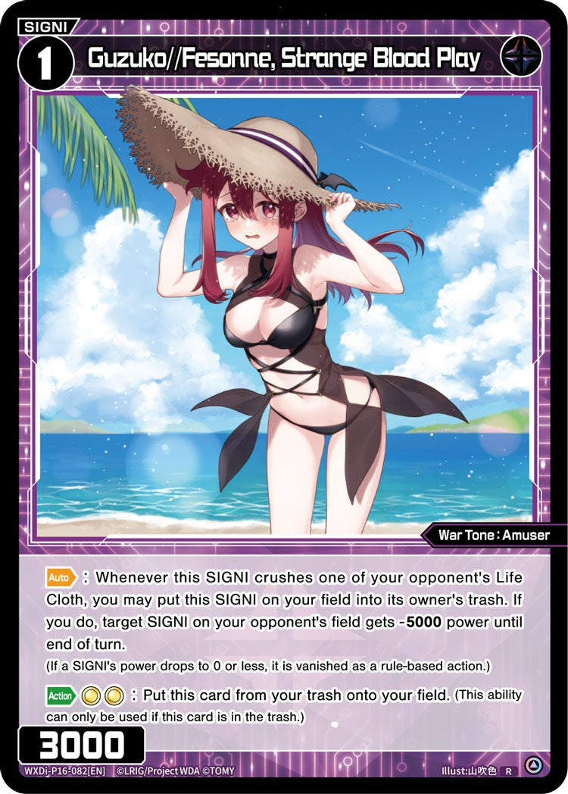

# Guzuko//Fesonne, Strange Blood Play

## Thông tin lá

| Trường | Giá trị |
| --- | --- |
| Mã in | WXDi-P16-082[EN] |
| Set | WXDi-P16[EN] |
| Số thứ tự | 082 |
| Loại thẻ | SIGNI |
| Vị trí | Main Deck |
| Số bản | — (set booster, không áp dụng) |
| Màu | Đen |
| Độ hiếm | R,R(P) |
| Minh họa | 山吹色 |
| Level | 1 |
| Limit | — |
| Power | 3000 |
| LRIG type / Class | War Tone：Amuser |
| Team / Master | — |
| Cost | — |
| Grow cost | — |
| Use timing | — |
| Life Burst | Không |

## Card text chính thức

[Auto]: Whenever this SIGNI crushes one of your opponent's Life Cloth, you may put this SIGNI on your field into its owner's trash. If you do, target SIGNI on your opponent's field gets -5000 power until end of turn.
(If a SIGNI's power drops to 0 or less, it is vanished as a rule-based action.)

[Action] {Coin Icon} {Coin Icon}: Put this card from your trash onto your field. (This ability can only be used if this card is in the trash.)

## Power text / Life Burst

—

## Ghi chú minh họa
Artist: 山吹色. Ảnh R được tải từ Card List tiếng Anh.

## FAQ chính thức

— (không có FAQ riêng cho mã này trên trang FAQ tiếng Anh.)

## Ảnh biến thể

- [R(P)](../images/WXDi-P16-082P-EN.jpg)

## Nguồn
[Card List/FAQ chính thức](https://www.takaratomy.co.jp/products/en.wixoss/card/card.html?card_no=WXDi-P16-082%5BEN%5D ) · [Ảnh thẻ](https://www.takaratomy.co.jp/products/en.wixoss/card/thumb/WXDi-P16-082%5BEN%5D.jpg)
