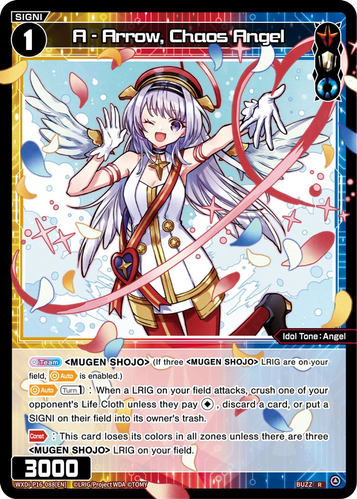

# A - Arrow, Chaos Angel

## Thông tin lá

| Trường | Giá trị |
| --- | --- |
| Mã in | WXDi-P16-088[EN] |
| Set | WXDi-P16[EN] |
| Số thứ tự | 088 |
| Loại thẻ | SIGNI |
| Vị trí | Main Deck |
| Số bản | — (set booster, không áp dụng) |
| Màu | Đỏ / trắng / xanh dương |
| Độ hiếm | R,R(P) |
| Minh họa | BUZZ |
| Level | 1 |
| Limit | — |
| Power | 3000 |
| LRIG type / Class | Idol Tone：Angel |
| Team / Master | — |
| Cost | — |
| Grow cost | — |
| Use timing | — |
| Life Burst | Không |

## Card text chính thức

[Team] <MUGEN SHOJO> (If three <MUGEN SHOJO> LRIG are on your field, [Team Auto] is enabled.)
[Team Auto] {1/Turn}: When a LRIG on your field attacks, crush one of your opponent's Life Cloth unless they pay {Colorless}, discard a card, or put a SIGNI on their field into its owner's trash.

[Constant]: This card loses its colors in all zones unless there are three <MUGEN SHOJO> LRIG on your field.

## Power text / Life Burst

—

## Ghi chú minh họa
Artist: BUZZ. Ảnh R được tải từ Card List tiếng Anh.

## FAQ chính thức

— (không có FAQ riêng cho mã này trên trang FAQ tiếng Anh.)

## Ảnh biến thể

- [R(P)](../images/WXDi-P16-088P-EN.jpg)

## Nguồn
[Card List/FAQ chính thức](https://www.takaratomy.co.jp/products/en.wixoss/card/card.html?card_no=WXDi-P16-088%5BEN%5D ) · [Ảnh thẻ](https://www.takaratomy.co.jp/products/en.wixoss/card/thumb/WXDi-P16-088%5BEN%5D.jpg)
