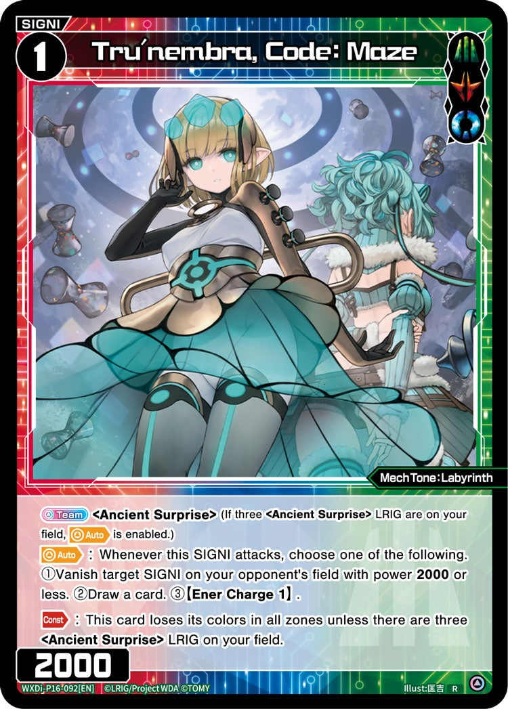

# Tru'nembra, Code: Maze

## Thông tin lá

| Trường | Giá trị |
| --- | --- |
| Mã in | WXDi-P16-092[EN] |
| Set | WXDi-P16[EN] |
| Số thứ tự | 092 |
| Loại thẻ | SIGNI |
| Vị trí | Main Deck |
| Số bản | — (set booster, không áp dụng) |
| Màu | Xanh lá / đỏ / xanh dương |
| Độ hiếm | R,R(P) |
| Minh họa | 匡吉 |
| Level | 1 |
| Limit | — |
| Power | 2000 |
| LRIG type / Class | Mech Tone：Labyrinth |
| Team / Master | — |
| Cost | — |
| Grow cost | — |
| Use timing | — |
| Life Burst | Không |

## Card text chính thức

[Team] <Ancient Surprise> (If three <Ancient Surprise> LRIG are on your field, [Team Auto] is enabled.)
[Team Auto]: Whenever this SIGNI attacks, choose one of the following. ①Vanish target SIGNI on your opponent's field with power 2000 or less. ②Draw a card. ③【Ener Charge 1】.

[Constant]: This card loses its colors in all zones unless there are three <Ancient Surprise> LRIG on your field.

## Power text / Life Burst

—

## Ghi chú minh họa
Artist: 匡吉. Ảnh R được tải từ Card List tiếng Anh.

## FAQ chính thức

— (không có FAQ riêng cho mã này trên trang FAQ tiếng Anh.)

## Ảnh biến thể

- [R(P)](../images/WXDi-P16-092P-EN.jpg)

## Nguồn
[Card List/FAQ chính thức](https://www.takaratomy.co.jp/products/en.wixoss/card/card.html?card_no=WXDi-P16-092%5BEN%5D ) · [Ảnh thẻ](https://www.takaratomy.co.jp/products/en.wixoss/card/thumb/WXDi-P16-092%5BEN%5D.jpg)
