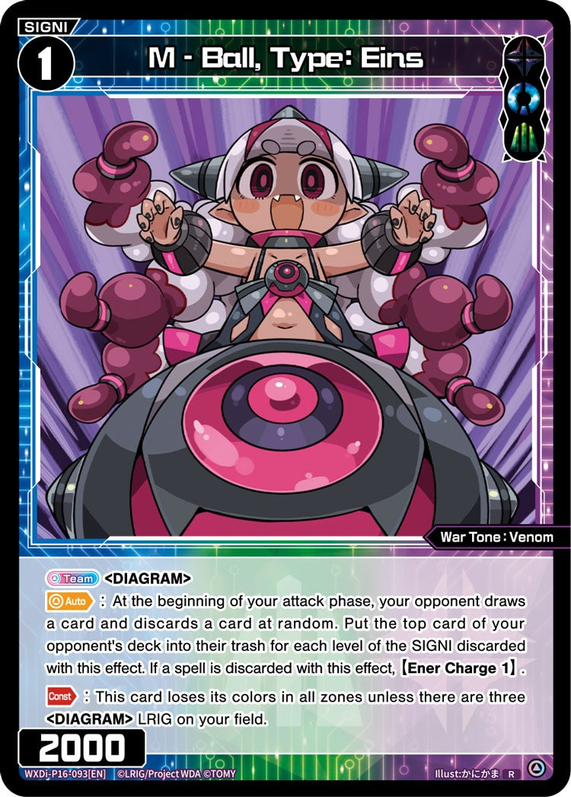

# M - Ball, Type: Eins

## Thông tin lá

| Trường | Giá trị |
| --- | --- |
| Mã in | WXDi-P16-093[EN] |
| Set | WXDi-P16[EN] |
| Số thứ tự | 093 |
| Loại thẻ | SIGNI |
| Vị trí | Main Deck |
| Số bản | — (set booster, không áp dụng) |
| Màu | Đen / xanh dương / xanh lá |
| Độ hiếm | R,R(P) |
| Minh họa | かにかま |
| Level | 1 |
| Limit | — |
| Power | 2000 |
| LRIG type / Class | War Tone：Venom |
| Team / Master | — |
| Cost | — |
| Grow cost | — |
| Use timing | — |
| Life Burst | Không |

## Card text chính thức

[Team] <DIAGRAM>
[Team Auto]: At the beginning of your attack phase, your opponent draws a card and discards a card at random. Put the top card of your opponent's deck into their trash for each level of the SIGNI discarded with this effect. If a spell is discarded with this effect, 【Ener Charge 1】.

[Constant]: This card loses its colors in all zones unless there are three <DIAGRAM> LRIG on your field.

## Power text / Life Burst

—

## Ghi chú minh họa
Artist: かにかま. Ảnh R được tải từ Card List tiếng Anh.

## FAQ chính thức

— (không có FAQ riêng cho mã này trên trang FAQ tiếng Anh.)

## Ảnh biến thể

- [R(P)](../images/WXDi-P16-093P-EN.jpg)

## Nguồn
[Card List/FAQ chính thức](https://www.takaratomy.co.jp/products/en.wixoss/card/card.html?card_no=WXDi-P16-093%5BEN%5D ) · [Ảnh thẻ](https://www.takaratomy.co.jp/products/en.wixoss/card/thumb/WXDi-P16-093%5BEN%5D.jpg)
