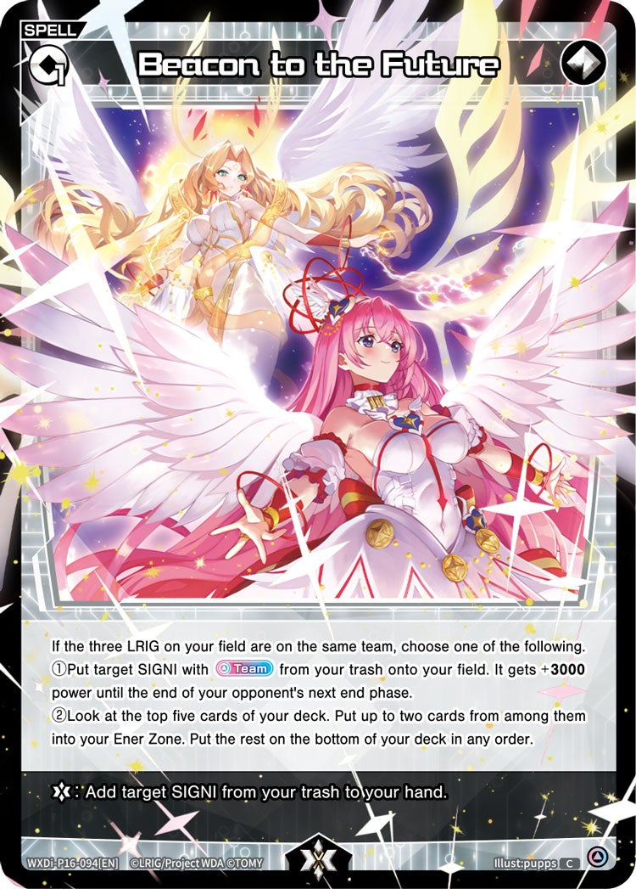

# Beacon to the Future

## Thông tin lá

| Trường | Giá trị |
| --- | --- |
| Mã in | WXDi-P16-094[EN] |
| Set | WXDi-P16[EN] |
| Số thứ tự | 094 |
| Loại thẻ | SPELL |
| Vị trí | Main Deck |
| Số bản | — (set booster, không áp dụng) |
| Màu | Không màu |
| Độ hiếm | C,C(P) |
| Minh họa | pupps |
| Level | — |
| Limit | — |
| Power | 0 |
| LRIG type / Class | — |
| Team / Master | — |
| Cost | 《C》×１ |
| Grow cost | — |
| Use timing | — |
| Life Burst | Có |

## Card text chính thức

If the three LRIG on your field are on the same team, choose one of the following.
①Put target SIGNI with [Team] from your trash onto your field. It gets +3000 power until the end of your opponent's next end phase.
②Look at the top five cards of your deck. Put up to two cards from among them into your Ener Zone. Put the rest on the bottom of your deck in any order.

## Power text / Life Burst

Add target SIGNI from your trash to your hand.

## Ghi chú minh họa
Artist: pupps. Ảnh C được tải từ Card List tiếng Anh.

## FAQ chính thức

— (không có FAQ riêng cho mã này trên trang FAQ tiếng Anh.)

## Ảnh biến thể

- [C(P)](../images/WXDi-P16-094P-EN.jpg)

## Nguồn
[Card List/FAQ chính thức](https://www.takaratomy.co.jp/products/en.wixoss/card/card.html?card_no=WXDi-P16-094%5BEN%5D ) · [Ảnh thẻ](https://www.takaratomy.co.jp/products/en.wixoss/card/thumb/WXDi-P16-094%5BEN%5D.jpg)
