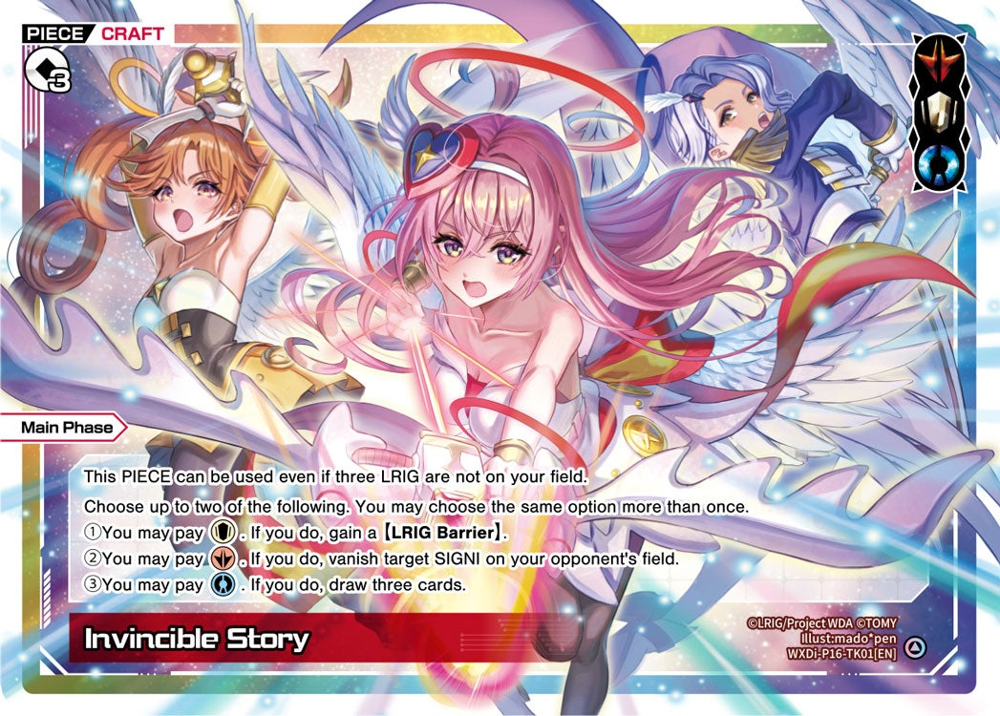

# Invincible Story

## Thông tin lá

| Trường | Giá trị |
| --- | --- |
| Mã in | WXDi-P16-TK01[EN] |
| Set | WXDi-P16[EN] |
| Số thứ tự | TK01 |
| Loại thẻ | PIECE CRAFT |
| Vị trí | LRIG Deck |
| Số bản | — (set booster, không áp dụng) |
| Màu | Đỏ / trắng / xanh dương |
| Độ hiếm | TK |
| Minh họa | mado*pen |
| Level | — |
| Limit | — |
| Power | 0 |
| LRIG type / Class | — |
| Team / Master | — |
| Cost | 《C》×３ |
| Grow cost | — |
| Use timing | Main Phase |
| Life Burst | Không |

## Card text chính thức

This PIECE can be used even if three LRIG are not on your field.

Choose up to two of the following. You may choose the same option more than once.
①You may pay {White}. If you do, gain a 【LRIG Barrier】.
②You may pay {Red}. If you do, vanish target SIGNI on your opponent's field.
③You may pay {Blue}. If you do, draw three cards.

## Power text / Life Burst

—

## Ghi chú minh họa
Artist: mado*pen. Ảnh TK được tải từ Card List tiếng Anh.

## FAQ chính thức

— (không có FAQ riêng cho mã này trên trang FAQ tiếng Anh.)

## Ảnh biến thể

- [TK](../images/WXDi-P16-TK01P-EN.jpg)

## Nguồn
[Card List/FAQ chính thức](https://www.takaratomy.co.jp/products/en.wixoss/card/card.html?card_no=WXDi-P16-TK01%5BEN%5D ) · [Ảnh thẻ](https://www.takaratomy.co.jp/products/en.wixoss/card/thumb/WXDi-P16-TK01%5BEN%5D.jpg)
